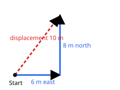

## Worked example: two straight paths at right angles

Ravi walks 6 m east and then 8 m north.

- **Distance** = 6 m + 8 m = **14 m**.
- **Displacement**: the start and end points form a right-angled triangle, so by Pythagoras
  the size is √(6² + 8²) = √100 = **10 m**, pointing north-east of the start.

On a circular track of radius r, half a lap gives distance πr but displacement 2r (straight across the
diameter); a full lap gives distance 2πr and displacement 0.
