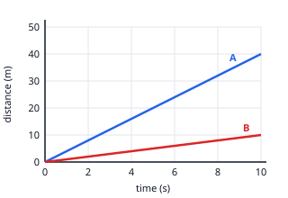

## Worked example: speed from a distance–time graph

Both cars start together. Each line is straight, so each car moves at a constant speed.

**Car A**: pick two points on its line, (0 s, 0 m) and (10 s, 40 m).

speed = change in distance ÷ change in time = (40 − 0) ÷ (10 − 0) = **4 m/s**

**Car B**: (0 s, 0 m) and (10 s, 10 m), so speed = 10 ÷ 10 = **1 m/s**.

A's line is steeper, so A is faster. After 5 s, A has gone 4 × 5 = 20 m and B has gone 1 × 5 = 5 m, so A is
15 m ahead.

If a line doesn't start at the origin, still use the *changes*: from (2 s, 10 m) to (6 s, 30 m) the speed is
(30 − 10) ÷ (6 − 2) = 20 ÷ 4 = 5 m/s.
