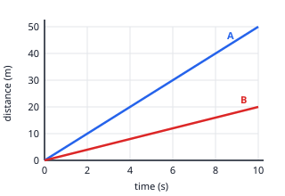

## Worked example: speed from a distance–time graph

Both cars start together. Each line is straight, so each car moves at a constant speed.

**Car A**: pick two points on its line, (0 s, 0 m) and (10 s, 50 m).

speed = change in distance ÷ change in time = (50 − 0) ÷ (10 − 0) = **5 m/s**

**Car B**: (0 s, 0 m) and (10 s, 20 m), so speed = 20 ÷ 10 = **2 m/s**.

A's line is steeper, so A is faster. After 6 s, A has gone 5 × 6 = 30 m and B has gone 2 × 6 = 12 m.

If a line doesn't start at the origin, still use the *changes*: from (2 s, 10 m) to (6 s, 30 m) the speed is
(30 − 10) ÷ (6 − 2) = 20 ÷ 4 = 5 m/s.
