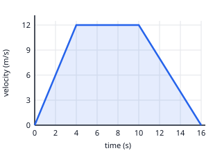

## Worked example: acceleration from a velocity–time graph

The graph has three straight parts. The slope of each part is the acceleration.

| Part | Change in velocity | Time | Acceleration |
|---|---|---|---|
| 0 → 4 s | 12 − 0 = 12 m/s | 4 s | 12 ÷ 4 = **3 m/s²** |
| 4 → 10 s | 12 − 12 = 0 | 6 s | **0** (constant velocity) |
| 10 → 16 s | 0 − 12 = −12 m/s | 6 s | −12 ÷ 6 = **−2 m/s²** |

A line going up means speeding up, a flat line means constant velocity, and a line going down means
slowing down (negative acceleration).
