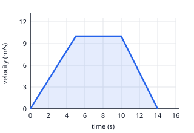

## Worked example: displacement from the area under a velocity–time graph

Use the same scooter trip. The shaded area under the line is the displacement.

Split the area into simple shapes:

- 0 → 5 s, a triangle: ½ × 5 × 10 = **25 m**
- 5 → 10 s, a rectangle: 5 × 10 = **50 m**
- 10 → 14 s, a triangle: ½ × 4 × 10 = **20 m**

Total displacement = 25 + 50 + 20 = **95 m**.

Why does this work? For constant velocity, displacement = velocity × time, which is the area of a
rectangle (height × width). The same idea holds for any shape.

For a straight line from u to v over time t, the area is a trapezium: ½ × (u + v) × t.
