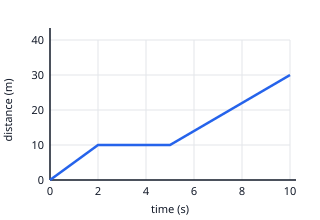

## Worked example: reading a graph of non-uniform motion

The cyclist's motion has three parts:

1. **0 → 2 s**: the line rises 10 m in 2 s, so the speed is 10 ÷ 2 = **5 m/s**, the steepest part.
2. **2 → 5 s**: the line is flat, so the cyclist is **at rest** for 3 s.
3. **5 → 10 s**: the line rises 20 m in 5 s, so the speed is 20 ÷ 5 = **4 m/s**.

**Average speed** for the whole trip = total distance ÷ total time = 30 ÷ 10 = **3 m/s**. The time at rest is
part of the total time.

A **curved** distance–time graph means the speed is changing: getting steeper means speeding up, and flattening
out means slowing down.

**Comparing two velocity–time graphs**: where the lines cross, the two objects have the *same velocity*, not
the same position. To compare how far each has gone, compare the areas under their lines.
