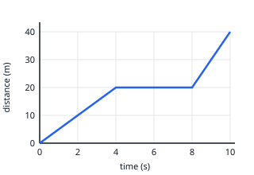

## Worked example: reading a graph of non-uniform motion

The toy car's motion has three parts:

1. **0 → 4 s**: the line rises 20 m in 4 s, so the speed is 20 ÷ 4 = **5 m/s**.
2. **4 → 8 s**: the line is flat, so the car is **at rest** for 4 s.
3. **8 → 10 s**: the line rises 20 m in 2 s, so the speed is 20 ÷ 2 = **10 m/s**, the steepest part.

**Average speed** for the whole trip = total distance ÷ total time = 40 ÷ 10 = **4 m/s**. The time at rest is
part of the total time.

A **curved** distance–time graph means the speed is changing: getting steeper means speeding up, and flattening
out means slowing down.

**Comparing two velocity–time graphs**: where the lines cross, the two objects have the *same velocity*, not
the same position. To compare how far each has gone, compare the areas under their lines.
