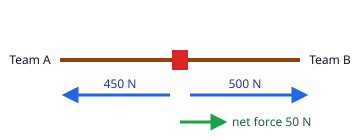

## Worked example: finding the net force

In a tug of war, team A pulls the rope to the left with 450 N and team B pulls to the right with 500 N.

Forces along a line combine like this:

- **Same direction**: add them.
- **Opposite directions**: subtract the smaller from the bigger. The net force points the way of the bigger one.

Here the forces are opposite, so the net force = 500 − 450 = **50 N to the right**. The forces are
**unbalanced**, so the rope (and both teams) start to move towards team B.

**Using signs**: take right as positive. Then 500 N to the right is +500 N and 450 N to the left is −450 N.
Net force = 500 + (−450) = +50 N. A negative answer would mean the net force points left.

If team A pulled with 500 N too, the net force would be 500 − 500 = 0: the forces would be **balanced**, and the
rope would not change its motion.

**Making forces balanced**: if a crate has 30 N + 20 N to the east and 40 N to the west, the net force is
50 − 40 = 10 N east. An extra 10 N to the west would balance it.
