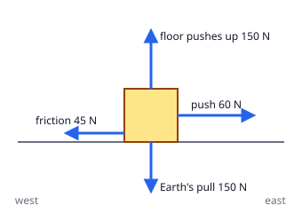

## Worked example: the forces on a box

A girl pushes a box along the floor. Four forces act on the box:

| Force | Direction | Size |
|---|---|---|
| The Earth's pull | down | 150 N |
| The floor pushing up | up | 150 N |
| The girl's push | east | 60 N |
| Friction from the floor | west | 45 N |

**Step 1: look at each line separately.** Up and down: 150 N and 150 N are balanced. East and west:
60 − 45 = 15 N towards the east, unbalanced.

**Step 2: the net force** is **15 N east**.

**Step 3: what happens?** An unbalanced force changes the motion: the box speeds up towards the east.

**Other examples**

- A book at rest on a table: the table pushes up with the same force as the Earth pulls down.
- A skydiver falling at a steady speed: air resistance up balances the Earth's pull down. The net force is
  zero even though she is moving.
- A ball thrown upwards, after it leaves the hand: only the Earth's pull acts (ignoring air). There is no
  "force of the throw" any more, which is why it slows down.
