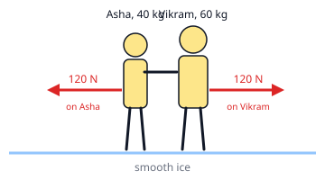

## Worked example: equal forces, unequal effects

Two skaters stand still on smooth ice. Asha (40 kg) pushes Vikram (60 kg) with a force of 120 N.

**Step 1: the forces.** Asha pushes Vikram forward with 120 N, so Vikram pushes Asha back with 120 N.
Each skater feels one force of the same size, in opposite directions.

**Step 2: each body on its own, a = F ÷ m.**

- Asha: a = 120 ÷ 40 = **3 m/s²**
- Vikram: a = 120 ÷ 60 = **2 m/s²**

The lighter skater gets the bigger acceleration. Asha's acceleration is 60 ÷ 40 = 1.5 times Vikram's: the
ratio of the accelerations is the *inverse* ratio of the masses.

**Recoil of a gun.** When a 4 kg gun fires a 20 g bullet, the gun pushes the bullet forward with, say,
800 N, and the bullet pushes the gun backward with 800 N.

- Bullet: m = 20 g = 0.02 kg, a = 800 ÷ 0.02 = 40 000 m/s²
- Gun: a = 800 ÷ 4 = 200 m/s², backward

The same force gives the light bullet a huge acceleration and the heavy gun a much smaller one. That backward
kick is the gun's **recoil**. Always change grams to kilograms before dividing.
